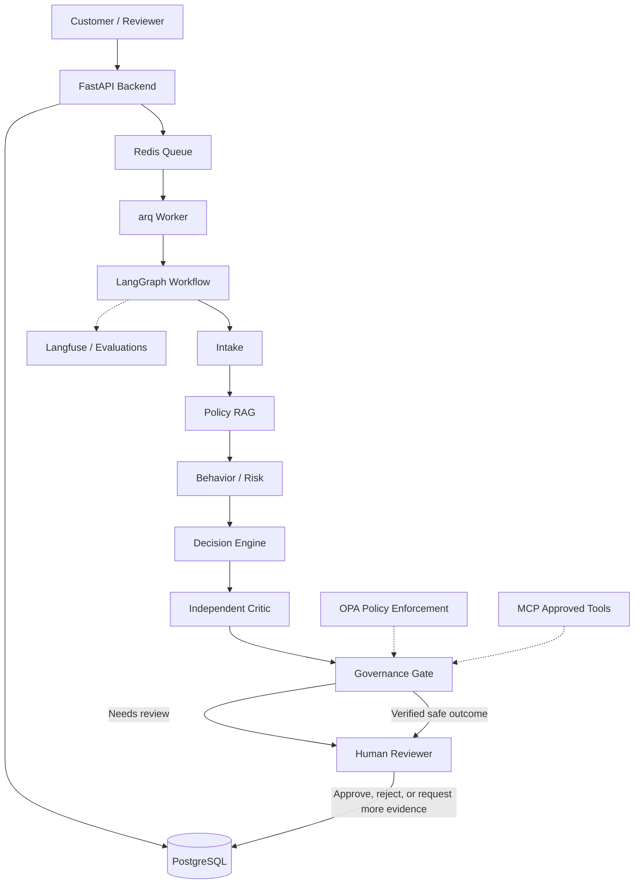

# Veto

**Veto** is a governed AI-powered ecommerce returns and refunds review system. It is designed to make return decisions auditable, policy-aware, and subject to human oversight.


## Architecture

The intended system will process return requests through a governed agent pipeline.



The broader design also considers Keycloak, Qdrant, Prometheus, Grafana, MinIO, MailHog, and Vault. These should be introduced only when a concrete phase requires them.

See the [architecture notes](Arch/ReverseGuard.txt) and [architecture diagram](Arch/Architecture.png) for more context.

## Repository layout

```text
.

├── backend/
│   ├── app/
│   │   ├── api/           # FastAPI routes
│   │   ├── db/            # SQLAlchemy models and database session
│   │   └── schemas/       # Pydantic request and response schemas
│   ├── Dockerfile
│   └── requirements.txt
├── docker-compose.yml
└── README.md
```


## Prerequisites

- Docker Desktop with Docker Compose
- Git

Python is only required if you want to run the backend outside Docker. The current Docker image uses Python 3.13.

## Run locally with Docker Compose

From the repository root:

```bash
docker compose up --build -d
```

Check service status:

```bash
docker compose ps
```

View logs:

```bash
docker compose logs -f backend
```

The services are available at:

- **API:** <http://localhost:8000>
- **Swagger UI:** <http://localhost:8000/docs>
- **ReDoc:** <http://localhost:8000/redoc>
- **PostgreSQL:** `localhost:5432`
- **Redis:** `localhost:6379`

Stop the services:

```bash
docker compose down
```

To also delete the persisted PostgreSQL volume and all data stored in it, run:

```bash
docker compose down -v
```

> **Warning:** `docker compose down -v` deletes the project's database volume. Do not run it if you need to keep your return records.

## API quick start

Check that the API is running:

```bash
curl http://localhost:8000/health
```

Expected response:

```json
{"ok": true}
```

Create a return:

```bash
curl -X POST http://localhost:8000/returns \
  -H "Content-Type: application/json" \
  -d '{"order_id":"order-123","reason":"Item arrived damaged","amount_cents":4999}'
```

The response includes a generated return UUID. Use that UUID to retrieve the record:

```bash
curl http://localhost:8000/returns/<return-id>
```

Replace `<return-id>` with the UUID returned by the create request.

Return records are currently associated with a configured demo user. Authentication and JWT-based identity are planned for a later phase.

## Configuration

The backend reads configuration from environment variables through `pydantic-settings`.

| Variable | Purpose | Local default |
| --- | --- | --- |
| `DATABASE_URL` | Async PostgreSQL connection string | Local PostgreSQL connection |
| `REDIS_URL` | Redis connection string | `redis://localhost:6379/0` |
| `DEMO_USER_ID` | Temporary user identity | `demo-user` |

When running through Docker Compose, the backend receives connection values from `docker-compose.yml`. Within Compose, services should use their service names (for example, `postgres` and `redis`) rather than `localhost` to connect to other containers.

Keep credentials in environment variables or an untracked `.env` file. Never commit real secrets.

## Development outside Docker

Docker Compose is the recommended development workflow. If you choose to run the backend directly on your host, first ensure PostgreSQL and Redis are available locally.

```bash
cd backend
python -m venv .venv
```

Activate the environment:

**Windows PowerShell**
```powershell
.\.venv\Scripts\Activate.ps1
```

**macOS / Linux**
```bash
source .venv/bin/activate
```

Install dependencies and start the server:

```bash
pip install -r requirements.txt
uvicorn app.main:app --reload
```

## Database notes

The application currently creates SQLAlchemy tables during startup. This is a development convenience; database migrations with Alembic are planned before production use.

PostgreSQL data is stored in the named Docker volume configured in `docker-compose.yml`, so restarting the backend container does not itself delete the records.

## Roadmap

1. **Async processing:** add an `arq` worker and queue return-processing jobs through Redis.
2. **Agent workflow:** implement the LangGraph pipeline with typed state, intake validation, decision logic, and a governance gate.
3. **Human review:** support pausing and resuming workflows, reviewer actions, and status updates.
4. **Authentication and frontend:** add JWT-based identity, authorization, and customer/reviewer interfaces.
5. **Governance and auditability:** introduce OPA policy enforcement, approved MCP tools, and tamper-evident audit logging.
6. **Specialized analysis:** add policy retrieval (RAG), risk scoring, independent decision critique, and—if justified—image analysis.
7. **Evaluation and observability:** build a labeled evaluation dataset and measure decision quality; add Langfuse and optional Prometheus/Grafana.
8. **Production hardening:** add migrations, durable job handling, retry/recovery policies, secrets management, and security testing.

The roadmap is incremental: components should be added when they solve a demonstrated need, rather than introducing every technology at the beginning.

## Security and limitations

- The current API uses a demo user identity; it is not a production authentication system.
- Return ownership checks and role-based authorization must be implemented before exposing the API to real users.
- Return eligibility must not be inferred from a valid request alone. Decisions should be grounded in verified order data and explicit policy rules.
- Human review should be available for uncertain or high-impact decisions.
- The current setup is intended for local development, not production deployment.

## Contributing

Contributions are welcome. Please open an issue to discuss substantial changes before submitting a pull request. Keep secrets in environment variables and do not commit local `.env` files, credentials, database files, or generated artifacts.

## License

No license has been selected yet. Until a license is added, all rights are reserved.
